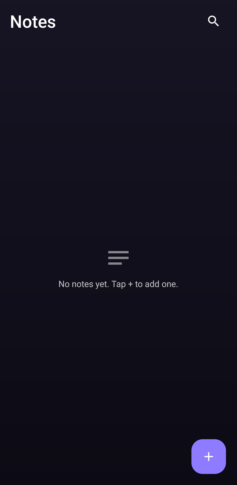
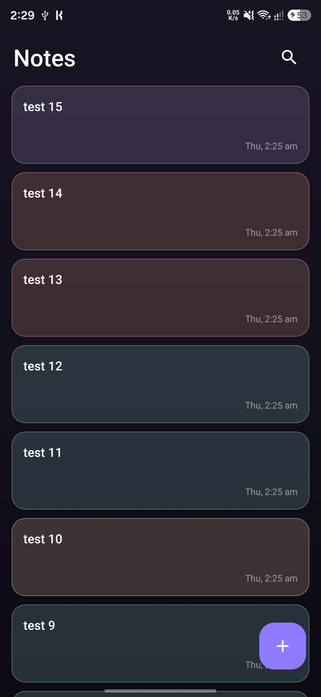
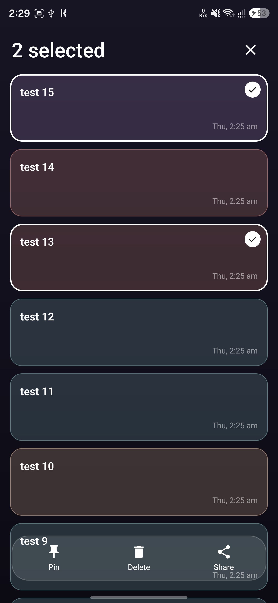
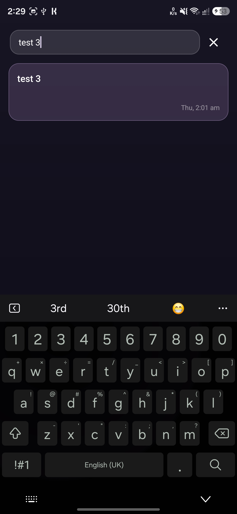
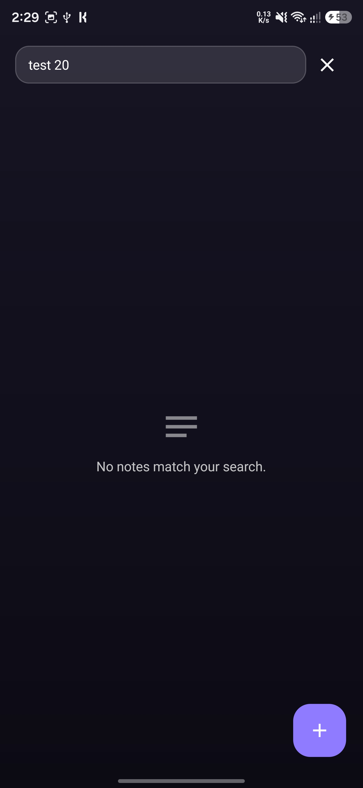
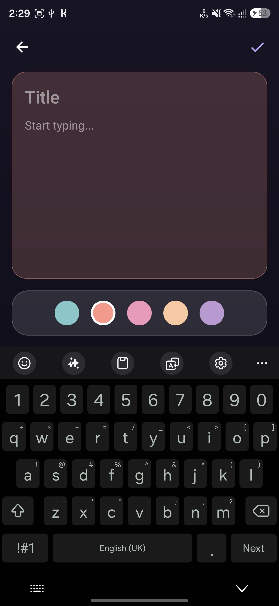
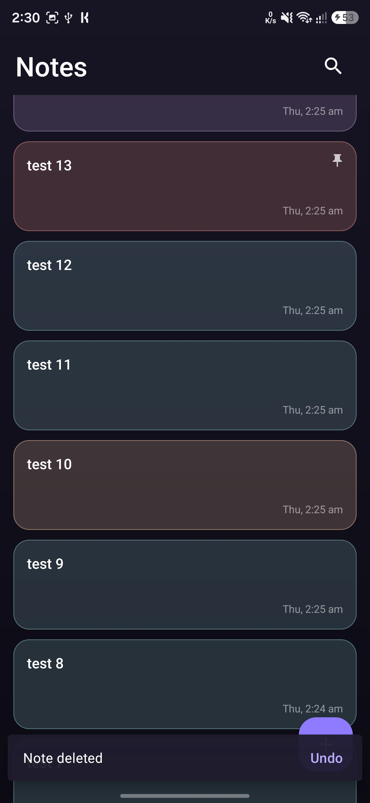

# Notes App

A dark, glassmorphic Android notes app. Create, edit, search, pin, share and delete notes, with each note keeping its own color. Everything is stored locally on the device.

Built as **Task 4** of the Auspify Technologies Android Developer Internship.

## Features

- Create and edit notes with a title, content and a color picked from five pastel tones
- Notes are stored locally with a Room database and stay saved after the app is closed
- Live search across note titles and content, opened from an expanding glass search field
- Press and hold a note to select it, then tap more notes to select several
- A glass action bar fades in for the selected notes: pin or unpin, delete, and share
- Pinned notes stay at the top of the list
- Delete with an Undo option
- Share one or several notes as plain text
- Friendly empty states for no notes and for no search results
- Glassmorphic dark design with tinted glass note cards
- Smooth animations: staggered list entrance, animated selection, fading action bar and editor transitions
- Selection, search and chosen color all survive screen rotation

## Tech Stack

- Kotlin
- Android Studio, XML layouts, View Binding
- Room database (with KSP)
- Kotlin Coroutines, Flow and StateFlow
- ViewModel and lifecycle-aware collection
- RecyclerView with ListAdapter and DiffUtil
- Material Components (Snackbar)
- Property animations and layout animations

## Screenshots

| Empty state | Note list | Selection and actions |
|---|---|---|
|  |  |  |

| Pinned notes | Search | No results |
|---|---|---|
|  |  |  |

| Note editor | Undo after delete |
|---|---|
|  |  |

## How to Run

1. Clone the repository
2. Open it in Android Studio
3. Let Gradle sync
4. Run on an emulator or a device with Android 10 (API 29) or higher

## Author

Ameer, Auspify Android Developer Intern